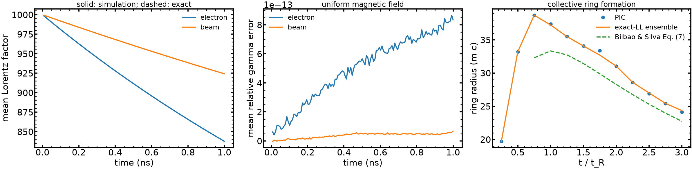
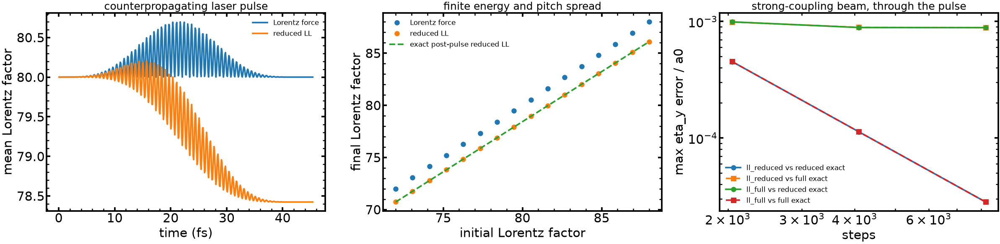

# Classical radiation reaction

`Radiation(model="ll_reduced")` adds the field-quadratic part of the classical
Landau–Lifshitz force to selected relativistic species. It represents recoil from
unresolved emission; it does not create photon particles or a radiation transport
field. This is the reduced model used in radiation-reaction PIC treatments such as
[Tamburini et al. (2010)](https://doi.org/10.1088/1367-2630/12/12/123005).
The field-derivative term of full Landau–Lifshitz is omitted. Small quantum effects
alone do not establish that this additional approximation is adequate for a rapidly
varying field. `Radiation(model="ll_full")` adds it for `Simulation.prescribed_fields`
only (see [below](#full-and-reduced-ll-through-a-pulse)); the default stays `ll_reduced`.

```python
from jaxincell import Radiation, Simulation, Solver, Species

# u0 has shape (n, 3), in m/s: it is p/m = gamma*v, not p/(m*c).
electrons = Species.electrons(n=n, density=density, x=x0, u=u0)
sim = Simulation(domain, (electrons,), Solver(relativistic=True),
                 external_B=B0_on_grid,
                 radiation=Radiation(species="electrons", substeps=1))
out = sim.run(steps)
```

`species=None` selects all species; a name or tuple of names selects a subset.
`radiation=None` leaves the Lorentz/collision model unchanged. The model and the
species selection are static JAX configuration. Physical fields, initial momentum,
charge, mass, and prescribed-field parameters remain differentiable leaves.

## Force and units

The simulation carries momentum per unit physical mass,
$\boldsymbol u=\gamma\boldsymbol v$, with
$\gamma=\sqrt{1+u^2/c^2}$. Let

```{math}
\tau=\frac{q^2}{6\pi\epsilon_0 m c^3},\qquad
\boldsymbol F=\boldsymbol E+\boldsymbol v\times\boldsymbol B,\qquad
Q=F^2-\frac{(\boldsymbol v\cdot\boldsymbol E)^2}{c^2}.
```

Here $q,m$ are one physical particle's charge and mass. The implemented acceleration
and physical emitted power are

```{math}
\boldsymbol a_{\rm RR}
=\tau\left(\frac qm\right)^2
\left[\boldsymbol F\times\boldsymbol B
 +\frac{(\boldsymbol v\cdot\boldsymbol E)\boldsymbol E}{c^2}
 -\frac{\gamma^2 Q}{c^2}\boldsymbol v\right],
\qquad
P_{\rm rad}=\tau\frac{q^2}{m}\gamma^2 Q.
```

The momentum equation is $d\boldsymbol u/dt=(q/m)\boldsymbol F+
\boldsymbol a_{\rm RR}$. The kernel returns $\boldsymbol a_{\rm RR}$ in m/s² and
$P_{\rm rad}$ in W. The planar particle weight $w$ is in m⁻² and enters only the
energy sum $\sum_p w_p P_p\,dt$, in J/m². Using weighted macroparticle charge or mass
inside this force would change the cooling rate when the particle count changes.

The displayed $Q$ suffers cancellation near a force-free trajectory and at high
Lorentz factor. The implementation instead defines

```{math}
\boldsymbol\eta=\boldsymbol u/c,\quad
\boldsymbol\beta=\boldsymbol\eta/\gamma,\quad
\boldsymbol f=\boldsymbol E/c+\boldsymbol\beta\times\boldsymbol B,\quad
\boldsymbol h=\boldsymbol\eta\times\boldsymbol f,\quad
S=f^2+h^2=\gamma^2 Q/c^2.
```

It evaluates the algebraically equivalent form

```{math}
\boldsymbol a_{\rm RR}=\tau(q/m)^2c\left[
\boldsymbol f\times\boldsymbol B
-(\boldsymbol\beta\cdot\boldsymbol f)(\boldsymbol\beta\times\boldsymbol B)
+(\boldsymbol\beta\times\boldsymbol f)\times\boldsymbol f
-h^2\boldsymbol\beta\right],
\qquad P_{\rm rad}=\tau(q/m)^2mc^2 S.
```

This uses a sum of squares, no clipped invariant, and no division by $|u|$. It keeps
finite derivatives at zero momentum and cancels the reduced force for parallel
$\boldsymbol E,\boldsymbol v$ with $\boldsymbol B=0$. In that last case the Larmor
power is positive. Mechanical reaction work and emission are therefore **separate
quantities**; defining one as minus the other would fail this basic control.

## Integration and the energy ledger

The explicit mover composes a midpoint Runge–Kutta radiation half-step, a relativistic
Boris step, and another radiation half-step. `Radiation.substeps` subdivides only
the two radiation half-steps, with the gathered fields held fixed; there is still
one original Boris Lorentz kick. It refines the local cooling map, but **does not
refine the Lorentz rotation, particle positions, deposited current, or sampled RF
phase**. Resolve those by decreasing `Domain.time_step`.

The implicit mover includes the radiation force at the midpoint momentum in the
particle/field Picard iteration. Its particle substep count is
`Solver.substeps * Radiation.substeps`. A radiation update after a converged
collisionless solve would solve a different discrete problem. The Picard residual,
iteration count, and time-step convergence remain part of the accuracy check.

Radiation or a time-dependent prescribed-field callback currently requires periodic
particle boundaries with the implicit solver. That combination is rejected for
implicit reflecting, absorbing, or thermal walls: the current, work, and emission
would all need a consistent split at the event. The explicit solver supports these
wall paths. A source entry window must also end before any newly loaded trajectory
reaches a wall; an unresolved crossing during that window invalidates the output.
Call `out.validate()` and shorten `Source.every` or the time step if it reports this
condition. The guard prevents work or radiation from being assigned to an already
collected particle.

Mechanical work uses the discrete kinetic-energy gradient

```{math}
\overline{\boldsymbol v}=
\frac{\boldsymbol u_0+\boldsymbol u_1}{\gamma_0+\gamma_1},\qquad
K_1-K_0=m\,\overline{\boldsymbol v}\cdot(\boldsymbol u_1-\boldsymbol u_0).
```

The emitted power is integrated at the radiation stage separately. `State.work`
contains per-species arrays; `Output.work` adds the stored-time axis. All entries are
in J/m²:

| field | meaning |
|---|---|
| `kinetic` | current particle kinetic energy, from carried momentum |
| `prescribed_work` | accumulated signed work on particles by static and time-dependent external electric fields |
| `rr_work` | accumulated signed mechanical work of the radiation force |
| `radiated_energy` | accumulated nonnegative physical emission |
| `collision_work` | accumulated signed kinetic-energy exchange in collisions, per species |

These arrays remain available when particle histories are disabled. With histories
enabled, use `out.u` for relativistic energies and momenta; reconstructing momentum
from a velocity that has rounded to $c$ loses information. `out.v` remains the velocity.

In a pure constant magnetic field, reaction work is minus radiated energy, and
$K+U_{\rm rad}$ gives a direct convergence check. General fields also exchange
near-field energy, and the reduced model omits the derivative force: an arbitrary
$K+U_{\rm rad}$ residual is not by itself a valid conservation test. Account for the
self-consistent field energy, prescribed work, collisions, boundaries, and sources
when they are present. A prescribed-particle work ledger is not a wave-source power
ledger.

## Exact magnetic cooling and derivatives

For uniform $\boldsymbol B=B\hat{\boldsymbol x}$, put
$a_B=\tau(qB/m)^2$. The radiation drift obeys

```{math}
\dot\eta_\parallel=-a_B\eta_\parallel\eta_\perp^2/\gamma,\qquad
\dot{\boldsymbol\eta}_\perp=-a_B(1+\eta_\perp^2)
\boldsymbol\eta_\perp/\gamma,\qquad
\dot\gamma=-a_B\eta_\perp^2.
```

The Lorentz force rotates the perpendicular vector without changing its magnitude.
The constant parallel velocity defines
$\Gamma_\parallel=[1-(v_{\parallel,0}/c)^2]^{-1/2}$ and
$g_0=\gamma_0/\Gamma_\parallel$. Then

```{math}
z(t)=\frac{g_0-1}{g_0+1}\exp(-2a_B t/\Gamma_\parallel),\qquad
\gamma(t)=\Gamma_\parallel\frac{1+z}{1-z}.
```

For a perpendicular orbit, $\Gamma_\parallel=1$ and
$\partial\gamma(T)/\partial B=-2a_B T[\gamma(T)^2-1]/B$ when the initial momentum
and observation time are fixed. This is an analytic derivative, independent of the
AD implementation.

Run `examples/2_intermediate/electron_cooling.py` for one electron and a beam with
energy and pitch spread. It uses physical electron parameters, $B=1000$ T,
$\gamma_0\simeq1000$ and a 1 ns window, with negligible collective fields. The
strong field is a chosen benchmark parameter; the radiation coefficient is unscaled.
The script compares the energy and its derivative to the exact solution and reports
gyrophase error separately. It does not claim collective-plasma cooling.

The kernel tests also cover zero fields, force-free motion, parallel E, magnetic
pitch damping, marker splitting, float32/high-$\gamma$ cancellation, and derivatives
at zero momentum. Refine a full orbit as well as the radiation substep: cooling can
converge well before gyrophase does.

## Collective ring formation

`electron_cooling.py` also reproduces the ring distribution of
[Bilbao and Silva](https://doi.org/10.1103/PhysRevLett.130.165101): an isotropic Maxwellian with 3D momentum spread
$p_{th}=50\,mc$ in $B=10^5$ T ($\chi_{th}=1.1\times10^{-3}$) cools perpendicular momentum faster than parallel, and
$f_\perp(p_\perp)=\int f\,dp_\parallel$ acquires a maximum away from the axis. Their ring radius
(their Eq. 7, $\tau=\tfrac23\alpha B_0\omega_{ce}t$, $B_0=B/B_S$)

```{math}
p_R=\frac{1+6p_{th}^2\tau^2-\sqrt{1+12p_{th}^2\tau^2}}{6p_{th}^2\tau^3},\qquad
t_R=\frac{3}{4\alpha\chi_{th}\omega_{ce}}=5.16\ \mathrm{ps}
\ \text{(their Eq. 8)}
```

assumes $p_\parallel\ll p_\perp$. The run uses 200,000 markers in 8 cells at $n=10^{22}\,\mathrm{m^{-3}}$
($\omega_p/\omega_{ce}=3.2\times10^{-4}$), self-consistent fields on, and 400 steps per $t_R$ (the gyrophase does not
matter to a homogeneous ensemble and Boris keeps $|p_\perp|$, so the step follows the cooling time). Ring radius
in $mc$:

| $t/t_R$ | 0.75 | 1 | 1.5 | 2 | 2.5 | 3 |
|---|---|---|---|---|---|---|
| PIC | 38.70 | 37.39 | 34.08 | 31.04 | 26.92 | 24.10 |
| exact-LL ensemble, same markers | 38.70 | 37.24 | 34.07 | 31.04 | 27.01 | 24.35 |
| Eq. (7) | 32.3 | 33.3 | 31.4 | 28.3 | 25.3 | 22.7 |

The PIC ring matches the exact-LL evolution of the same markers to 1% (the difference is estimator noise). The
radius peaks near $0.75\,t_R$ and then shrinks as $1/\tau$; $f_\perp(p_R)/f_\perp(\text{core})=9.2$ at $3\,t_R$,
an inverted population. Eq. (7) is 8-12% below the exact ring for $t\ge1.5\,t_R$ and up to 19% at $0.75\,t_R$,
where $p_\parallel\ll p_\perp$ fails (the paper also notes the early-time mismatch); the example gates the
$t\ge1.5\,t_R$ agreement at 15% and does not claim the formula is accurate earlier.

Per-particle $|p_\perp|$ against the exact uniform-$B$ solution: 99th percentile $1.95\times10^{-3}$, worst
$1.3\times10^{-2}$, with the worst markers at small $p_\perp$ and large $p_\parallel$. This is self-field noise,
not integration error: at $n=10^{10}$ with the same step and markers the worst is $6.8\times10^{-7}$
(20,000 markers), and it does not shrink with `Radiation.substeps`. No maser growth is expected or looked for:
$\Gamma t_R\sim\tfrac12(\omega_p/\omega_{ce})^2p_{th}\approx2.5\times10^{-6}$ (their Eq. 9). The field is
$10^5$ T, far above laboratory fields, chosen to make $t_R$ short while $\chi_{th}\ll1$; the paper's physical
timescale is $t_R\propto B^{-2}$. The classical force is used throughout; the mean $\chi$ of this ensemble is
$1.4\times10^{-3}$.



*Left and middle: single-electron and beam magnetic cooling against the exact solution; right: ring radius.
Produced by `examples/2_intermediate/electron_cooling.py` on this branch, default settings, float64, CPU.*

## Prescribed RF and a finite-time control example

Run `examples/3_advanced/runaway_rf.py` for a short control demonstration through the
actual `Simulation` time loop. The chosen setup is a dilute electron seed at
$\gamma_0=40$, $B_0=2$ T, with a counterpropagating mode at 476 MHz and
$k_\parallel=-20$ rad/m. These are demonstration inputs, not a reproduction of a
particular experiment. Resonant RF pitch scattering of relativistic electrons is
established experimentally; see
[Choudhury et al.](https://doi.org/10.1103/jz8f-ck22).

The callback uses a fixed periodic wave number and the vector potential

```{math}
A_y=\frac{E_*}{\omega}g(t)\sin(kx-\omega t),\qquad
A_z=\frac{E_*}{\omega}g(t)\cos(kx-\omega t).
```

It returns $\boldsymbol E_{\rm RF}=-\partial_t\boldsymbol A$ and
$\boldsymbol B_{\rm RF}=\nabla\times\boldsymbol A$, including the envelope derivative.
A time-dependent multiplier on the monochromatic relation
$\boldsymbol B=\boldsymbol k\times\boldsymbol E/\omega$ would miss that term.
The envelope and its first derivative vanish before the final RF-off interval.
No quasilinear diffusion is applied on top of this resolved mode.

Four bounded coefficients shape an 8 ns pulse, followed by 2 ns with RF off. The
smooth finite-time response is
$R(T)=\langle u_\perp^2/u^2\rangle$. SLSQP uses JAX derivatives to minimize

```{math}
J=\frac{1}{E_*^2 T_c}\int_0^{T_c}\langle E_{\rm RF}^2\rangle_x\,dt
=\frac{1}{T_c}\int_0^{T_c}\left[g^2+(\dot g/\omega)^2\right]dt,
```

subject to a target rms $\sin\theta$ and a fixed 0.5% design margin. The script checks
a directional derivative against central differences, then repeats the optimized
control with half the time step and twice the gyro-phase samples. Assertions enforce
the derivative check, the target in both runs, a declared refinement tolerance, and
a reduction in field exposure. This verifies a best-found control in a fixed finite parameterization; it is not a global optimum
or a long-time response derivative.

The dimensional field exposure is $J E_*^2 T_c$, in V² s/m². **It is not input energy.**
The script separately prints prescribed particle work, mechanical reaction work,
physical emission, and kinetic-energy change, in J/m², together with the instantaneous
magnetic cooling time after the RF pulse. The physical radiation loss during this
short window is tiny. A vacuum intensity conversion is not a power calibration for a
supplied plasma mode, and signed negative particle work would mean extraction, not a
minimum positive input-power cost.

A sustained runaway-control calculation additionally needs a specified accelerating
field/current source, a thermal bulk or explicit reservoir, validated relativistic
collisions, and primary/avalanche sources when they matter. A long-time reduced RF
response must be checked against resolved trajectories, including coherent trapping
and energy transfer; phase diffusion at fixed energy cannot simply be assumed.
Minimum **source power** requires an explicit source/Poynting balance, bulk absorption,
returned and retained wave energy, and suppression throughout a declared RF-off hold.
Those are subsequent physics and validation gates, not results of this example.

## Laser–beam cooling

`examples/3_advanced/beam_laser.py` follows a dilute beam with energy, pitch and
gyrophase spread through a counterpropagating 800 nm pulse. Its compact potential
is $A_y=mc\,a(\phi)/e$, with
$a=a_0\cos^2[\phi/(2N)]\sin\phi$ for $|\phi|<\pi N$ and zero outside.
For integer $N\geq2$, the potential and its first two derivatives vanish at the
edges. The callback evaluates $E_y=-mc\omega a'/e$ and $B_z=E_y/c$.

Writing $s=\gamma-\eta_x$ and $\rho=\tau\omega$, the reduced-LL phase equations are

```{math}
s'=-\rho(a')^2s^2,\qquad (\eta_y/s)'=a'/s,\qquad \eta_z/s=\text{constant}.
```

The odd potential gives $\int a(a')^2d\phi=0$. With
$I=\pi a_0^2(3N+1/N)/8$ and $h=1+\rho s_0 I$, the complete-pulse result is

```{math}
s_f=s_0/h,\qquad \eta_{\perp f}=\eta_{\perp0}/h,\qquad
\gamma_f=\frac{h^2+s_0^2+|\eta_{\perp0}|^2}{2hs_0}.
```

The script checks this endpoint, an independent phase ODE, no-RR canonical and
light-front invariants, work/emission, timestep convergence and an analytic
amplitude derivative. At 8,192 steps its maximum final-gamma error is $1.59\times
10^{-8}$ and the amplitude-derivative error is $1.44\times10^{-6}$ relative;
the mean gamma decreases from 80 to 78.42357. These are classical-model numerical
errors: the bound $\chi<0.0082$ does not bound quantum corrections at that level.
The full LL solution's extra endpoint terms vanish for this special complete
pulse, so the endpoint cannot test the omitted term; the next section does.
The incident fluence equals the initial pulse energy per area; it is distinct
from particle work and from boundary energy crossing this box during the run.

## Full and reduced LL through a pulse

Full Landau–Lifshitz adds $\tau(q/m)\gamma[D_t\boldsymbol E+\boldsymbol v\times D_t\boldsymbol B]$,
$D_t=\partial_t+\boldsymbol v\cdot\nabla$. In the plane-wave phase variables it leaves $s=s_0/h$ unchanged and
adds $\rho g'$ to $(\eta_y/s)'$, with $g=a'$. Di Piazza's exact solution is

```{math}
\eta_y=\frac{\eta_{y0}+\rho s_0 g-\rho s_0\int a(a')^2d\phi}{h}+a,\qquad
\eta_z=\eta_{z0}/h,
```

and the reduced model is the same without $\rho s_0 g$. `beam_laser.py` checks this closed form against a
separate DOP853 integration of the full-LL phase equations (difference $2.7\times10^{-13}$ of $a_0$ for the
default beam, $2\times10^{-10}$ for the strong beam below), then runs both models at 2,048, 4,096 and 8,192
steps. $\eta_y$ is compared through the whole pulse by mapping each output sample to its phase
$\phi=\omega[t-(x-x_0)/c]-\pi N$. Maximum $\eta_y$ errors in units of $a_0$:

| beam | model | vs own exact, 2,048 / 4,096 / 8,192 | vs other exact, 8,192 | model gap |
|---|---|---|---|---|
| default ($\gamma_0\approx80$, $a_0=15$, $\chi\le0.008$) | `ll_reduced` | 4.48e-4 / 1.12e-4 / 2.80e-5 | 2.81e-5 | 2.6e-6 |
| | `ll_full` | 4.48e-4 / 1.12e-4 / 2.80e-5 | 2.81e-5 | |
| strong ($\gamma_0\approx3\times10^4$, $a_0=1$, $\chi\le0.19$) | `ll_reduced` | 4.52e-4 / 1.13e-4 / 2.83e-5 | 8.84e-4 | 8.85e-4 |
| | `ll_full` | 4.52e-4 / 1.13e-4 / 2.83e-5 | 8.85e-4 | |

Each model converges at second order (ratio 4.00) to its own solution. The model gap does not converge. For the
default beam it is ten times below the integration error at 8,192 steps, so the term cannot be seen; for the
strong beam it is 31 times the finest `ll_full` error. The gap scales as
$\rho s_0\approx\tfrac23\alpha\chi/a_0$: for $a_0\gtrsim1$ and $\chi\ll1$ it is below $5\times10^{-3}\chi$ of
the Lorentz momentum, smaller than the radiation reaction itself by $1/a_0$. The strong beam is deliberately
outside the classical validity range ($\chi$ of order 0.2 invites quantum corrections that dwarf the term); it only
shows that the implementation reproduces the exact term where it is visible.

**Decision.** `ll_full` is kept as an opt-in model, not the default. It needs the explicit solver, periodic
particle boundaries, no sources and a `prescribed_fields` callback, whose derivatives are taken by four
forward-mode passes per step; self-consistent and gridded fields keep the reduced force. On the CPU test case
(2,000 markers, 4,096 steps, a loaded laptop) a step with no radiation took 2.45 s, `ll_reduced` 4.61 s and
`ll_full` 6.49 s, a 41% cost over reduced. Where $\chi\ll1$, as here, the reduced model is adequate.



*Mean Lorentz factor, final Lorentz factor against the exact reduced-LL result, and through-pulse $\eta_y$ error
convergence of both models for the strong beam. Produced by `examples/3_advanced/beam_laser.py`, default settings,
float64, CPU.*

## Mover convergence and Picard controls

Uniform $B=1000$ T, $\gamma_0=1000$, 1 ns (28 gyroperiods), one electron, compared with the exact solution.
Maximum errors at the end, explicit versus implicit (8 Picard iterations, 2 particle substeps), laptop CPU:

| steps | explicit $\gamma$ error | explicit phase (rad) | implicit $\gamma$ error | implicit phase (rad) |
|---|---|---|---|---|
| 512 | 3.66e-9 | 2.25 | 2.14e-3 | 0.78 |
| 1,024 | 9.14e-10 | 0.572 | 5.40e-4 | 0.197 |
| 2,048 | 2.29e-10 | 0.144 | 1.35e-4 | 0.0493 |
| 4,096 | 5.71e-11 | 0.0359 | 3.39e-5 | 0.0123 |

Both movers are second order (error ratio 4.00 per halving) in energy and phase. The explicit energy error is
about $6\times10^{5}$ times smaller at equal step because its radiation half-steps are Runge–Kutta and the Boris
rotation is exact in $|p_\perp|$; the implicit midpoint force makes a larger, still second-order, energy error.

Controls at 1,024 steps: explicit `Radiation.substeps` 1/2/4/8 reduce the energy error 9.14e-10, 2.29e-10, 5.71e-11,
1.43e-11 (second order) and leave the phase error (0.572 rad) untouched, as stated above. In the implicit scheme
the Picard error saturates at the discretization error: 1, 2, 3 iterations give 7.89e-4, 5.403e-4, 5.402e-4 and
4 or 8 give 5.402e-4 with identical phase. Particle `substeps` 1/2/4/8 give 2.14e-3, 5.40e-4, 1.35e-4, 3.39e-5
and phase 0.78, 0.197, 0.0493, 0.0123 rad; the `Radiation.substeps` multiplier of the particle orbit substeps gives
the same sequence. Use `picard_tolerance` to check closure and increase `Domain.time_step` resolution (explicit) or
particle `substeps` (implicit) to reduce the error. Timings were taken under heavy load and are not recorded.

## A prescribed source-energy benchmark

`examples/3_advanced/rf_source_control.py` uses a cold neutral electron–proton
plasma with a four-cycle, 500 MHz drive. Its linear response has an independent
five-frequency solution. The simulation is spatially uniform; finite-wave-number
checks separately verify the analytic Maxwell identities. There is no radiation,
collision or runaway suppression in this source-accounting example.

For the prescribed vector potential, the external current and its supplied power
per area are

```{math}
\boldsymbol J_{\rm ext}=\epsilon_0(c^2\nabla\times\boldsymbol B_p-
\partial_t\boldsymbol E_p),\qquad
P_s=-\int\boldsymbol J_{\rm ext}\cdot(\boldsymbol E_s+\boldsymbol E_p)\,dx.
```

The plasma current already drives the self fields; subtracting it again would
double count it. The periodic energy balance includes
$U_\times=\epsilon_0\int(\boldsymbol E_s\cdot\boldsymbol E_p+
c^2\boldsymbol B_s\cdot\boldsymbol B_p)dx$:
$\Delta(K+U_s+U_p+U_\times)=\int P_sdt$. The example checks convergence of this
external diagnostic, including the large error from omitting cross energy.
It is not a new exact discrete production conservation law.

The declared ideal actuator supplies all positive instantaneous work and dumps
returned energy: $Q_+=\int\max(P_s,0)dt$, $Q_-=\int\max(-P_s,0)dt$.
Their difference equals signed source work. A physical port with reactive storage
or recovery needs that model; arbitrary cycle-average bins change the cost and
can change pulse rankings. This example does not estimate wall-plug power.

Four bounded Bernstein coefficients minimize $Q_+$ for a fixed terminal
plasma-energy target. Frozen controls are checked at 512, 1,024 and 2,048 steps.
The best-found pulse lowers supplied energy by 2.18% relative to flat amplitude;
minimizing field exposure instead raises supplied energy by about 0.98%.
Peak field, current and power are reported but have no independent constraint.
This is a finite control-family result, not a global minimum or a runaway result.

Source-power zero crossings matter for derivatives. The script integrates the
positive area of the linearly interpolated endpoint powers before rectification,
and uses the same endpoint trapezoid for signed work. It checks triangle areas,
isolated-zero sensitivity, AD/finite differences and quadratic homogeneity.
AD agreement with the same discrete quadrature alone cannot establish a continuum
gradient. The default displays a figure; `JIC_RF_OUTPUT` optionally names a results
directory outside the checkout. Keep generated reports and plots out of Git.

## Quantum parameter and mean recoil

For a charge $q$ of mass $m$ the local quantum parameter is
$\chi=\sqrt S\,|q|\hbar/(m^2c^2)=\sqrt S/B_S$, with $S$ the invariant above (in
T$^2$). `State.work.chi_emission` accumulates $\int\sum_p w_pP_p\chi_p\,dt$ for
every radiating species, in J/m². Divided by `radiated_energy`, which
`diagnostics(out)["chi_mean"]` does, it is the emission-weighted mean $\chi$. It is a
mean, not a maximum: a few particles at $\chi\sim1$ in a cold bulk can be
hidden in it, so also bound $\chi$ from the fields and $\gamma$ for the run.

The synchrotron formation length is $\bar\lambda_C/\chi$ with
$\bar\lambda_C=\hbar/mc$. The locally constant crossed-field approximation needs
this to be short against the field's scale $c/\omega$, that is
$a=\chi\,mc^2/(\hbar\omega)\gg1$:
{func}`~jaxincell.lcfa_parameter` evaluates $a$ for an `omega` the user supplies. The
code does not know a field's frequency, so it reports no verdict.

`Radiation(model="ll_quantum")` multiplies the reduced force and the emitted power by
the Gaunt factor of [Niel et al. (2018)](https://doi.org/10.1088/1361-6587/aab3b3),

```{math}
g(\chi)=\left[1+4.8(1+\chi)\ln(1+1.7\chi)+2.44\chi^2\right]^{-2/3},
```

the fit to the constant-crossed-field emitted power divided by its classical value.
This lowers the mean recoil. It does not sample photons, include the stochastic
diffusion of the momentum, or conserve anything beyond the mean energy and momentum
exchanged; the reduced model's neglect of field derivatives remains. Time stepping and
the energy ledger are those of `ll_reduced`; `radiated_energy` is the quantum power.

Independent gates, all in `tests/test_kernels.py` and `tests/test_physics.py`:

| check | reference | result |
|---|---|---|
| $g(0)=1$, $\chi\to0$ | Bessel moments, $g'(0)=-55\sqrt3/16$ | fit slope $-5.44$ against $-5.954$ (9% low) |
| $g(\chi)$, $10^{-6}\le\chi\le10^3$ | quadrature of the nonlinear-Compton spectrum | at most 1.4% in value |
| $dg/d\chi$ | derivative of that quadrature | at most 8.6%, at $\chi\to0$ |
| $\chi\to\infty$ | $16\Gamma(2/3)/(27\cdot3^{1/3})\chi^{-4/3}$ | within 1% at $\chi=10^5$ |
| kernel $\chi$, power ratio | $\gamma B/B_S$ from CODATA constants; quadrature | 1e-4; within 2.5% |
| emitted energy in `Simulation` | $g(\chi)$ times the `ll_reduced` energy | $10^{-3}$, explicit and implicit |
| gradient of cooled $\gamma$ with respect to $B$ | central finite differences | $10^{-6}$ |

The fit is accurate in value but not in slope: a gradient of $g$ is biased by up to 9%,
and the bias of $d(\chi^2g)/d\chi$ is smaller (1.8% in the audit of
`handoff/continuation/quantum`). A control gradient through $\chi\sim0.1$ to 1 should
state that bias. The tests also confirm that the gradient of the product $Sg(\chi)$ is
finite at zero field, where $g$ alone has an infinite slope in $S$.

## Next stages and their gates

These are not implemented. Each has an acceptance gate that must be passed before
the stage is called available; none may be relaxed to obtain a pass.

1. **Fokker–Planck diffusion** (energy diffusion beyond the mean loss). Add the
   momentum diffusion of Niel et al. (2018). Gates: the one-step second moment of the
   energy loss equals the quadrature of the spectrum's second moment, within 5%; the
   mean follows $g(\chi)$; at $\chi\to0$ the diffusion vanishes as $\chi^3$ and the
   run reduces to `ll_quantum`; the stationary energy-spread of an ensemble in a
   constant magnetic field follows the Fokker–Planck solution; ensemble statistics,
   not one trajectory, are compared; gradients are those of expectations over a fixed
   random stream, with a variance estimate.
2. **Stochastic photon emission.** Sample the emitted energy from the
   nonlinear-Compton spectrum with a Monte Carlo event probability, in a $\chi$ range
   the spectrum sampler is checked in. Gates: the emitted-energy distribution passes a
   Kolmogorov–Smirnov test against the quadrature at several $\chi$; the mean over
   many emissions equals the `ll_quantum` rate within the sampling error; the
   probability per step is below 1% (or the step is split); energy and momentum are
   conserved per event; the sampled mean loss at small $\chi$ reproduces `ll_reduced`; the memory and cost of the photon register is reported;
   discontinuous sampling is not differentiated, so gradients use an expectation
   or a score-function estimator with its variance.
3. **Pair creation.** A photon of parameter $\chi_\gamma$ creates a pair with the
   Erber rate. Gates: the rate against the published constant-crossed-field value over
   $0.1\le\chi_\gamma\le20$; exponential attenuation of a photon beam through a
   region of constant field; charge, energy and momentum conserved per event;
   created particles are inserted without breaking the Gauss-law ledger. This is new
   physics, a separate `Species` and not a `Radiation` switch.

All three need the locally constant field validity to be demonstrated with
$a\gg1$ for the field in use; for $a\sim1$ the emission is not local in the field.

## Validity of the classical model

For electrons, the local quantum parameter is $\chi=\sqrt S/B_S$, with $B_S\simeq4.4140\times10^9$ T.
The classical model requires $\chi\ll1$ and a justified neglect of the field-derivative
term. Neither `Radiation.substeps` nor a smaller time step changes that model range.
`ll_quantum` corrects the mean recoil only. There is no photon sampling, pair creation, or
automatic transition to another model.
